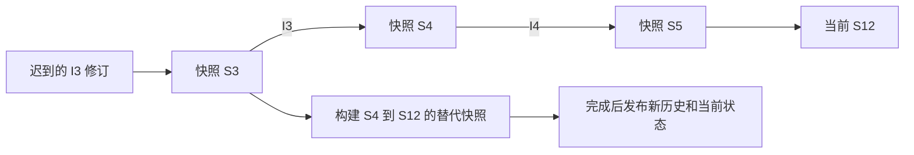

# 确定性与回滚设计

## 时间线



状态 `S(t+1) = Step(S(t), I(t))`。`SetInput` 发现旧输入改变时，先在局部列表中构造整个替代时间线，完成后更新输入日志和快照；当前已经返回给调用者的快照始终不变。重复输入直接返回 `Unchanged`。

窗口 H 在当前 tick C 保留快照 `[max(initialTick, C-H), C]`。最旧快照仍可接收输入，因为它恰好是该输入执行前的状态。更旧的输入无法正确重演，必须明确拒绝。输入帧随着历史窗口一起删除；未来输入最多允许到 `C+F`，避免无界排队。

## 状态转换规则

每个轴独立计算：非零输入给速度增加 `input × acceleration`；中性输入以 `drag` 向 0 靠近且不越过 0；然后钳制到最大速度、推进坐标。越出墙面时钳制坐标并清零速度。恰好到墙面不算越界，下一 tick 若继续向外才清零。

所有计算用 `long`；配置将边界和速度限制为不超过 10^9，且加速度不超过最大速度。初始状态同时验证这些范围，所以中间加法不会接近 `long` 溢出。tick 使用 `int` 且显式 `checked`；`Advance` 先验证完整 tick 数量。

`WorldState` 的构造由库控制，玩家按 ID 排序、ID 唯一且非负；`Body` 和 `PlayerInput` 为值类型，玩家集合是只读包装。配置是只读 record；通过 `with` 只能创建新配置，不能修改已有状态。

## 哈希协议 SIM1

固定字节序为小端，每个整数的宽度固定：

| 字段 | 字节数 |
| --- | --- |
| ASCII `SIM1` | 4 |
| tick | 4 |
| HalfExtent、Acceleration、MaxSpeed、Drag | 每项 8 |
| 玩家数量 | 4 |
| 每位玩家的 ID | 4 |
| 每位玩家 X、Y、VelocityX、VelocityY | 每项 8 |

最后对字节串取 SHA-256，输出小写十六进制。加入配置可避免两个规则不同的世界在静止时偶然显示相同摘要。格式标记为将来规则变化预留明确版本边界。

初始单玩家默认状态的独立校验：

```python
import hashlib, struct
payload = b'SIM1' + struct.pack('<iqqqqiiqqqq', 0, 10000, 3, 40, 1, 1, 0, 0, 0, 0, 0)
print(hashlib.sha256(payload).hexdigest())
# e8468f7527a8826f0b312341a84308fc9259b92d3ef757369a28b563191d58f8
```

测试将两类证据结合：单步数值结果与独立 decimal 分支模型比较，回滚结构与完整按时输入时间线比较。后者单独不能证明物理规则正确，因此同时保留独立模型和已知边界结果。

## 扩展边界

接入真正网络时还需要会话标识、消息去重、同一 tick 修订顺序、权威快照与协议校验。若加入随机玩法，必须将固定算法 RNG 的状态放入 `WorldState` 并纳入哈希；若加入外部浮点物理，当前确定性保证不再自动成立。这里不声称跨所有运行时或硬件都经过测试，CI 的 Linux 与本地 Windows 运行只验证已覆盖环境。
